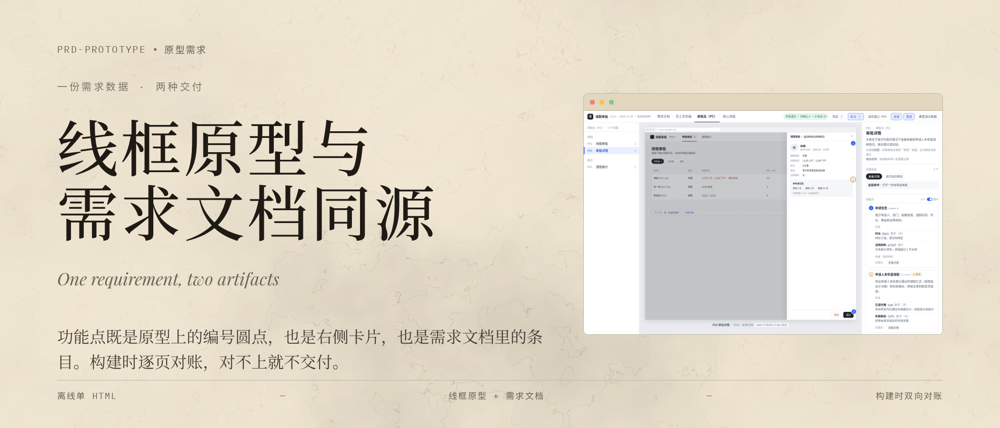
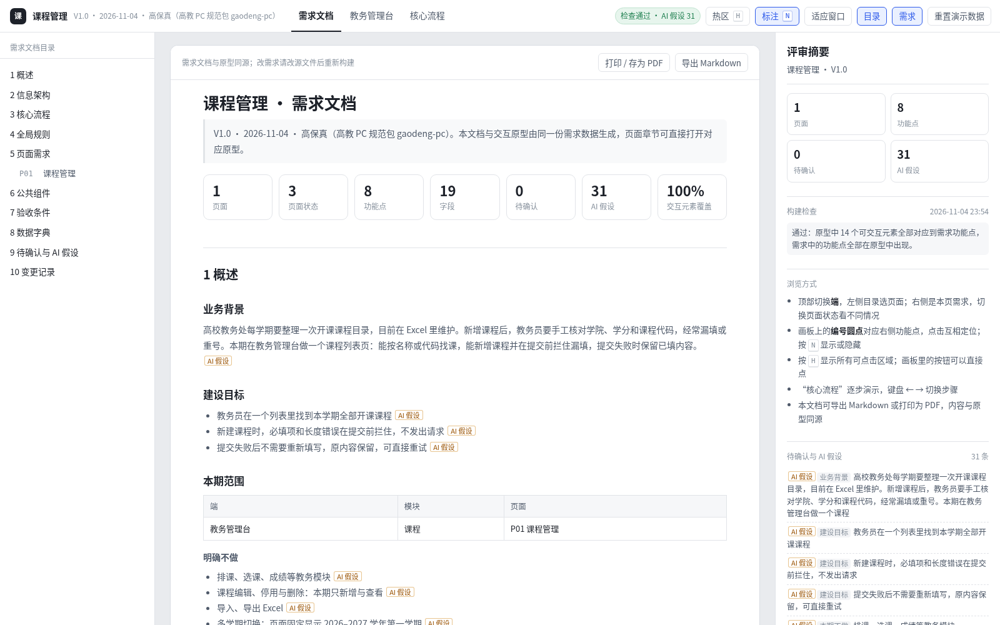
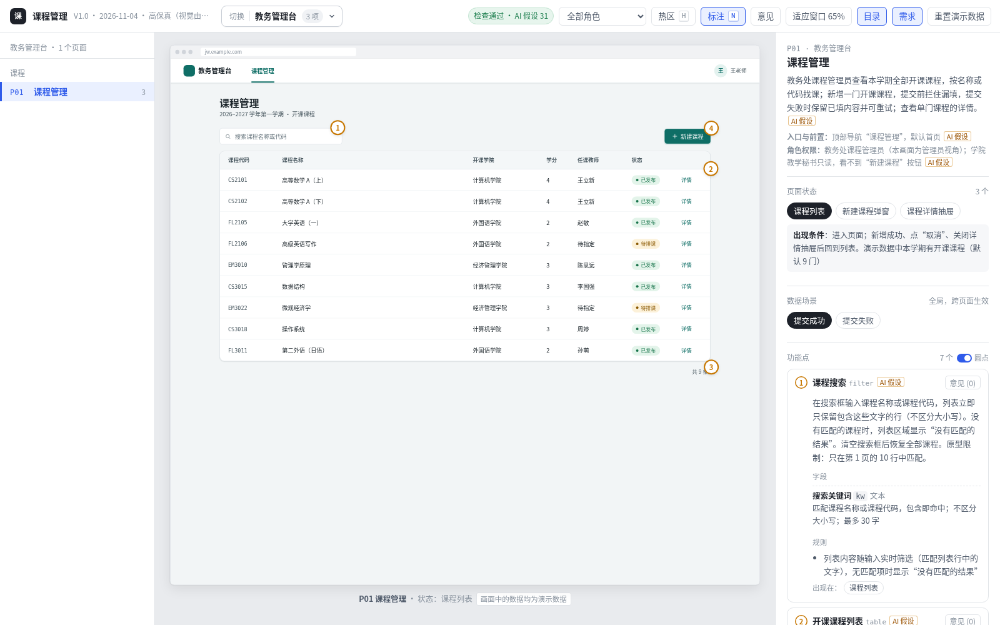
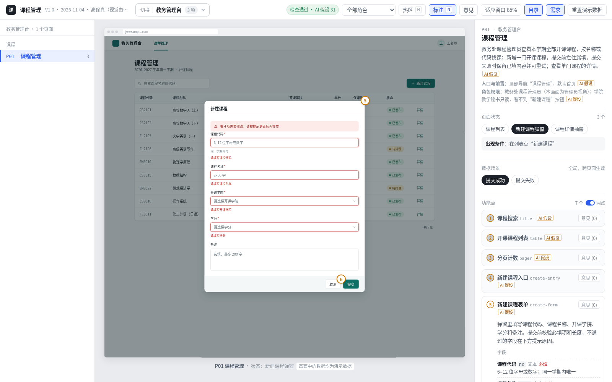
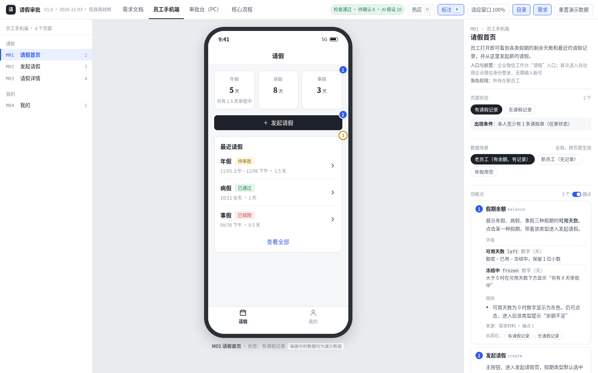
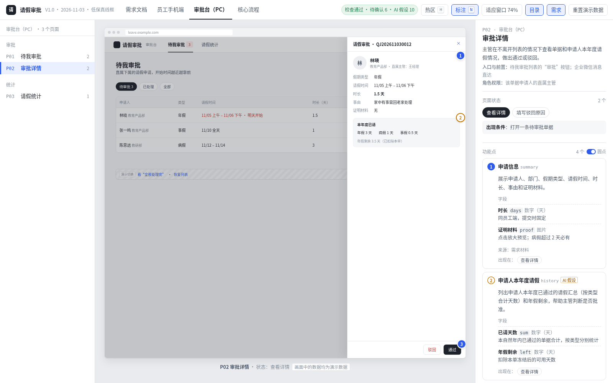
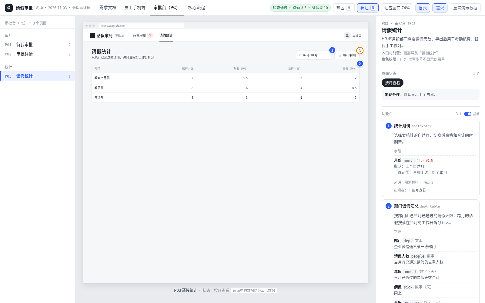
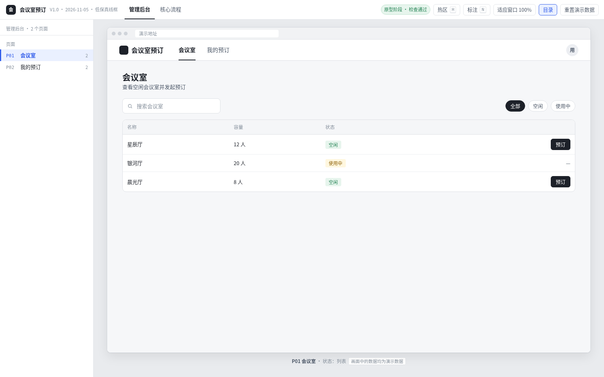
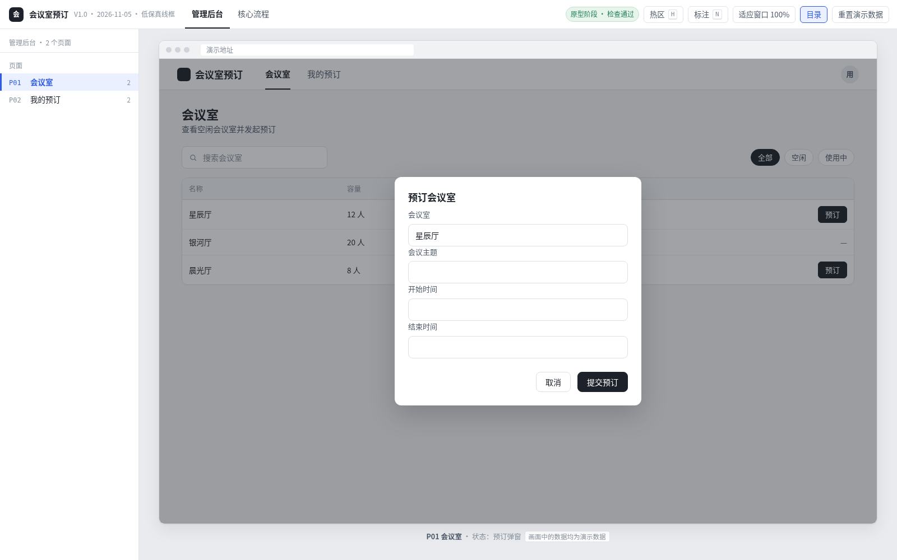

# 原型需求 · prd-prototype

> 一份需求数据，同时生成可点击的原型（线框或高保真）和完整的需求文档，打包成一个离线 HTML。



[](CHANGELOG.md)
[](LICENSE)
[](#交付物长什么样)
[](#安装)

「原型需求」是一个面向 AI Agent 的产品技能。它用同一份数据同时生成原型和需求文档：原型上的编号圆点、右侧的功能点卡片、需求文档里的条目，都指向同一个功能点。

构建时，脚本用无头浏览器逐页、逐状态渲染原型，并和需求数据逐项对账，对不上就不交付。

## 解决什么问题

| 团队反馈的问题 | 做法 |
| --- | --- |
| AI 生成原型时，多出很多需求里没有的功能 | 原型里的每个按钮、链接、输入框都必须归属已登记的功能点，否则构建失败 |
| 照着 HTML 写需求，常漏掉交互说明或数据定义 | 按原型实际渲染出的元素反查：每个状态要有出现条件，有输入就要有字段定义和必填说明，有列表就要有空数据说明，有提交或删除就要有异常处理 |
| 只给几句话就生成原型，AI 容易自由发挥 | 先轻量澄清（最多 2 轮、每轮不超过 6 题、每题带推荐答案），确认范围清单后才开始画；无依据的内容必须标“AI 假设”或“待确认” |
| 原型和文档分成两份文件，研发和测试对照着看很费劲 | 只交付一个 HTML：左侧页面目录、中间原型画板、右侧本页需求；顶部“切换”下拉框可切到需求文档（全文，可导出 Markdown）、各端原型或核心流程 |

## 交付物长什么样

- **需求文档**（首页）：包含概述与范围、角色权限、信息架构、核心流程、全局规则、逐页需求（页面目标、状态与出现条件、功能点、字段表、规则、异常与边界）、公共组件、数据字典、需求与原型的差异、待确认与 AI 假设、澄清记录、变更记录。
- **顶部切换**：一个下拉框，可切换需求文档、各端原型（标有 PC 或手机、页面数）和核心流程。窗口宽度 ≤ 1100 时顶栏分两行，下拉框在第一行，工具按钮在第二行；手机宽度下，下拉框占满第一行。支持键盘操作：↓ 打开，↑ ↓ Home End 移动，Enter 选中，Esc 收起。
- **各端页面**：提供 PC 浏览器框或手机框画板。画板上的编号圆点与右侧功能点卡片一一对应，点击可互相定位并高亮目标区域。弹层状态下只显示最上层的功能点。
- **核心流程**：支持逐步演示，直接点击画板里的按钮也能推进步骤。
- **按流程真点检查**（1.4.0）：构建时，无头浏览器会按每条核心流程从第 1 步真实点击到最后一步，核对点到的页面状态、画面是否与按“下一步”演示一致；写了 `see`（如 `'待审批'`）的步骤，画面里没看到就不交付。`snap.mjs --flows` 会按同样方式逐步截图，交付前必跑。
- **总流程图**：在需求文档“核心流程”章节开头和流程演示页上方，按 `flows` 自动生成一张总图：一页一个方框，每端一种颜色，箭头标流程编号，写了 `branch` 的分支条件用橙色标在箭头上。点击可放大，适合汇报投屏。
- **工具**：热区（`H`）、标注圆点（`N`）、缩放、目录和需求面板开关、数据场景切换、重置演示数据、本版变化、意见、角色下拉（配置 `product.roles` 时，可按角色过滤画板与需求卡片）。
- **意见**：评审人可在功能点上留意见并导出 JSON 文件。意见只存在评审人本地浏览器中，不上传服务器，每条都会记录提出时的版本。用 `scripts/merge-comments.mjs` 可将多份 JSON 合并成 Markdown，先按版本、再按功能点分组，区分本轮意见和历史意见，方便需求作者或 Agent 逐条处理。
- **研发测试清单**：功能点、字段、验收条件可导出为 CSV（UTF-8 带 BOM，Excel 可直接打开）。交付 HTML 内不提供 CSV 下载（需求文档栏只有「导出 Markdown」，1.3.0 起原型阶段也去掉了「清单」按钮）；需通过命令行 `build.mjs --csv` 生成三份 CSV，或用 `--export-pack` 一并导出每页截图和清单.md。
- **声明式交互**：表单必填与长度校验、提交（防重复点击、失败后可重试、成功后更新列表）、搜索筛选，均由组件直接实现，对应规则会自动写入需求文档。
- **范围基线**：新项目确认范围后会写入 `prd/scope.json`；没有该文件的旧项目也能正常构建，只是不做增删对比。后续新增或删除页面、状态、功能点时会给出提醒，并在需求文档中单列“范围确认后新增”。
- **验收条件**（可选）：功能点可填写 `ac`（前置条件、用户操作、预期结果），会自动汇总到需求文档的“验收条件”章节。
- **断网门槛**：构建时在断网环境下检查。托管原型若引用了网络脚本或样式，会阻止交付。确需联网的端须配置 `online: true`，交付物会标明“需联网”。
- **高保真**（可选）：`new.mjs --hifi` 会生成样式骨架 `prd/theme.css`。配色、字阶、间距、组件状态由 Agent 按产品特点自行设计（做法见 `references/hifi.md`），不绑定特定公司的设计规范。需求编写与对账检查和线框模式完全一致。

## 真实截图

以下截图均由技能直接生成，未经手工绘制或修图。生成流程：先用 `build.mjs` 构建 `examples/` 下的样例，再用 `snap.mjs` 截图。图中均为演示数据，画板下方标有“画面中的数据均为演示数据”。

### 高保真样例：课程管理（视觉由 AI 自拟）



需求文档首页，顶部统计数字和右侧评审摘要均由构建结果自动生成。



课程列表页，画板上的编号圆点与右侧功能点卡片一一对应。配色和组件样式定义在样例的 `prd/theme.css` 中，由 AI 按“高校教务后台”风格自拟。



新建课程弹窗，提交空表单时，未通过校验的必填项会在字段下方提示原因。

### 线框样例：请假审批



手机端请假首页。



PC 审批详情抽屉，左侧列表保持可见，右侧叠出详情抽屉。



HR 请假统计页。

## 两种用法

**从需求开始（原生）**：输入需求材料或几句话，先做轻量澄清并确认范围清单，再编写需求数据和页面，构建对账通过后交付。默认生成线框；需要高保真时加 `--hifi`，视觉样式统一写在 `prd/theme.css` 中，页面代码里不写色值。

**给已有 HTML 补需求（托管模式）**：保留同事已有的 AI 原型不改动，放进 sandbox iframe 中运行，通过选择器把功能点绑定到原有页面元素上。原型里有但本期不做的元素用虚线框标出；需求里有但原型没画的功能单独列出。适合“手里已有 HTML，但 PRD 对不上”的场景。

## 原型阶段：先出样子，需求以后再补

如果需求还没定，只想先让领导或同事看下产品样子，可以在 `prd/product.js` 里加上 `stage: 'prototype'`。

- 功能点只需写编号和名称，暂不写交互说明、字段和异常处理，这些缺失项只会提示提醒，不报错。
- 产物文件名为 `<产品名>-原型.html`。打开直接进入第一个端的首页，顶部切换下拉框没有“需求文档”，右侧没有需求面板，编号圆点默认隐藏（按 `N` 可开启，刷新不保存显示状态）。
- 顶部状态栏显示“原型阶段 · 结构检查通过”。
- 原型结构本身照常严格检查：多画但未登记的按钮、登记了却没画出的功能点、写错的字段或跳转，依然会阻止交付。
- 原型阶段不支持用 `--md` 导出需求文档，执行会直接报错。托管模式（已有 HTML 补需求）同样支持原型阶段：元素绑定和 `ignore` 仍需编写，虚线框和圆点默认隐藏，按 `N` 显示。
- 等需求确定后，删掉 `stage` 这一行重新构建，原本降级为提醒的需求检查会恢复为错误，报错列表就是接下来要补齐的需求项。

注意：原型阶段不是跳过检查的后门。需求已经明确的项目，不要开启这个配置。





## 安装

环境要求：

- Node.js 18 或更高版本。
- 本机装有 Chrome、Edge 或 Chromium（构建检查和截图需要调用浏览器；如果自动找不到，可设置环境变量 `CHROME_PATH`）。

无需通过 npm 安装任何依赖。

将整个 `prd-prototype/` 目录复制到 Agent 的 Skills 目录下即可，例如：

```text
~/.claude/skills/prd-prototype
~/.codex/skills/prd-prototype
~/.kiro/skills/prd-prototype
```

## 怎么说

```text
使用 prd-prototype，根据 docs/需求.md 做一个交互原型和需求文档。
```

```text
使用 prd-prototype，给 demo/发布任务.html 补需求，PRD 在 demo/发布任务-PRD.md。原型画面保持原样。
```

```text
使用 prd-prototype，按评审意见修改 ./课堂签到 项目：补签需要填写原因。
```

```text
使用 prd-prototype，基于 ./请假审批 做 V1.1：统计页支持导出明细，去掉申请人历史。
```

## 命令

```bash
node prd-prototype/scripts/new.mjs <项目目录> --name "产品名" --id short-name --end pc:管理后台 --end mobile:员工手机端
node prd-prototype/scripts/new.mjs <项目目录> --name "产品名" --id short-name --end pc:管理后台 --hifi
node prd-prototype/scripts/new.mjs <项目目录> --name "产品名" --host 已有原型.html
node prd-prototype/scripts/probe-host.mjs 已有原型.html [--steps '[...]'] [--shot a.png]
node prd-prototype/scripts/build.mjs <项目目录> [--md] [--csv] [--export-pack]
node prd-prototype/scripts/build.mjs <项目目录> --scope-baseline --confirmed-at 2026-11-04
node prd-prototype/scripts/snap.mjs <产物.html> [--flows] [--view "#/p/P01/list"]
node prd-prototype/scripts/merge-comments.mjs 意见A.json 意见B.json -o 评审意见合并.md [--prd <项目目录>]
node prd-prototype/scripts/test-skill.mjs
```

命令说明：

- `new.mjs`：初始化项目骨架。`--hifi` 开启高保真（生成样式骨架，PC 端画板 1440×900），`--host` 开启托管模式。
- `build.mjs`：构建并对账，再按核心流程真实点击跑一遍（写了 `see` 却没看到会阻止交付，其余不一致仅提醒）。`--md` 同时导出需求文档 Markdown；`--csv` 导出功能点、字段、验收条件三份 CSV（原型阶段也可用）；`--export-pack` 导出研发包（CSV + 每页截图 + 清单.md）；`--scope-baseline` 在确认范围增删后刷新 `prd/scope.json`。
- `probe-host.mjs`：探测已有 HTML 的页面结构和潜在风险点。
- `snap.mjs`：截取交付物的各个视图，用于检查画面。`--flows` 会按核心流程真实点击并逐步截图，交付前必跑。
- `merge-comments.mjs`：把交付物里导出的多份评审意见 JSON 合并成带序号的 Markdown。
- `test-skill.mjs`：运行技能自身的回归测试。

## 样例

`prd-prototype/examples/leave-approval/` 是线框基线样例：员工在手机端发起请假，主管在 PC 端审批，HR 查看统计。包含表单及静态画出的校验失败状态、底部确认弹层、列表、抽屉叠弹窗、数据场景切换、两条核心流程，以及待确认和 AI 假设标记。直接打开 `请假审批-原型需求.html` 即可查看。如果要用组件声明表单校验、提交和搜索，请参考下面的课程管理样例。

`prd-prototype/examples/course-mgmt/` 是 PC 高保真样例，视觉由 AI 自拟（`prd/theme.css`、`prd/theme-kit.js`）。这是一个课程管理后台，包含列表搜索与分页、新建课程弹窗（校验、提交失败后重试、列表更新）和课程详情抽屉。业务内容均为 AI 假设，已在文档中标出。直接打开 `课程管理-原型需求.html` 即可查看。

## 质量

运行 `node prd-prototype/scripts/test-skill.mjs` 应全部通过。测试覆盖：

- 两个样例构建及托管模式构建。
- 20 余类门禁反例：每类都必须拦截成功，且不覆盖已有交付文件。
- 托管模式反例。
- 断网门槛：`HOST_NET` 拦截，`online: true` 放行。
- 范围基线：`SCOPE_ADDED`、`SCOPE_REMOVED` 检查及 `--scope-baseline` 刷新。
- 声明式交互：校验（含复选框、开关）、提交、搜索筛选、`FIELD_REQ`，以及提交按钮或搜索框匹配不到表单/列表时的 `BEHAVE` 报错。
- 高保真：`--hifi` 骨架、`--theme` 已移除的提示、旧项目自带 `theme.css` / `theme-kit.js` 兼容纳入、PC 作用域、对话框、分页、缺省页。
- 版本迭代与归档。
- 评审意见：填写意见、刷新保留、导出 JSON、原型阶段与托管原型阶段的意见面板、多份意见合并，以及按提出版本分组、旧数据标“版本未知”。
- 研发测试导出：需求文档栏仅保留「导出 Markdown」且能正常导出、CSV 内容与转义、`--csv` 生成三份文件、原型阶段移除「清单」按钮、托管模式导出、`--export-pack` 研发包，以及检查失败时不输出文件。
- 总流程图：自动汇总（分区、方框、编号、配色）、`branch` 分支、同页分支合并、`flowMap: false` / 手写 / 写错处理、SVG 预渲染且不内嵌 Mermaid、两次构建 SVG 一致、跨端虚线、手写 Mermaid 图带文字、文档与演示页展示、点击放大。
- 按角色看原型：`ROLE_ID` 校验、顶栏角色下拉、秘书角色隐藏新建按钮、公共组件、原型阶段与托管模式按 `sel` + `text` 过滤、刷新后记住已选角色。
- 浏览器端交互：顶部切换下拉框（1600、1024、390 宽度，支持点选、键盘操作、点击外部收起，选择后快捷键仍生效）、圆点定位、状态切换、弹层层级、流程演示、快捷键、窄屏适配、托管状态识别、sandbox 隔离。
- 内容安全：DOMPurify 清洗。
- 脚手架生成。

## 目录

```text
docs/images/         README 题图与截图
prd-prototype/
├─ SKILL.md            技能入口与流程
├─ references/         澄清、需求格式、组件、高保真、托管模式、版本迭代、检查代码
├─ assets/runtime/     浏览器外壳、组件、文档生成、检查逻辑
├─ assets/template/    新项目模板
├─ assets/vendor/      Marked、DOMPurify、Mermaid 及许可
├─ scripts/            新建、构建、探测、截图、回归测试
├─ examples/           完整样例
└─ tests/fixtures/     托管模式夹具
```

版本更新记录见 [CHANGELOG.md](CHANGELOG.md)。

## 来源与许可

- 浏览结构（页面目录、热区、页面状态、核心流程、缩放、重置数据）参考了团队内部的一期交互线框原型。
- 版本迭代、内容安全、单文件审计等思路来自「原型标注」技能（基于 [lin96008-maxlin/prototype-annotation](https://github.com/lin96008-maxlin/prototype-annotation) 二次开发，MIT 许可）。
- 轻量澄清借鉴了 [mattpocock/skills](https://github.com/mattpocock/skills) 中 grilling 的做法：每题附推荐答案，回复“是”即采纳，能自己查到的事实绝不追问，并去掉了“问到所有分支走完为止”的繁琐流程。
- 题图由 [Guizang Social Card Skill](https://github.com/op7418/guizang-social-card-skill) 的 Editorial 模板生成（AGPL-3.0 许可，题图源文件不在本仓库中）。
- 第三方组件说明见 [THIRD_PARTY_NOTICES.md](THIRD_PARTY_NOTICES.md)。本项目代码按 [MIT License](LICENSE) 发布。
